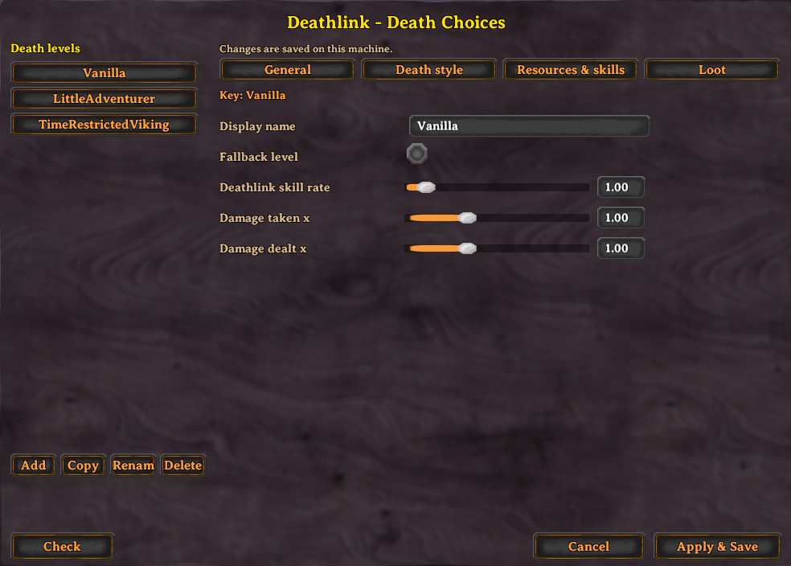

# Deathlink - Configureable Death & Difficulty

Deathlink provides the ability to completely configure role specific difficulty, bonuses, penalties and death experience.
In addition to extensive configuration, death penalties and bonuses can be scaled by progression.

Bringing together players from many different experience levels often means that some players struggle while others are bored.
Deathlink provides a way to challenge and reward players based on their appetite for risk.


## Example Deathlink Choices
| Vanilla | Minimal | Hardcore |
|:-:|:-:|:-:|
|   |   |   |


## Configuration
Deathlink has extensive yaml based configuration options. However it can be used with the default configuration.

A visual configuration UI is also available (to admins), allowing complete editing of death choices.



Each of these configuration sections below can be applied to any number of profiles which users can select.
Each character picks one, and by default the choice is stored on the character, so it follows them to every
world. With `UsePrivateKeysForDeathChoice = false` choices are instead kept in the server's
`CharacterSettings.yaml`, so a character can have different choices on different servers.

The server's BepInEx config (`MidnightsFX.Deathlink.cfg`) has the other settings, each with a description.
The ones most servers change are `DefaultDeathChoice` (a level new characters get without being asked),
`AllowedDeathChoiceChanges` (how often a player may change their choice from the compendium),
`ItemsNotSkillChecked` (items handled by `NonSkillCheckedItemAction` instead of the death style) and
`EnableLeaderboard`.

`DeathChoices.yaml` is written with a full explanation of every setting at the top of the file, so you can
configure it without coming back here. Edits are picked up while the game is running and are pushed to
connected clients automatically.

Settings are matched without regard to case, so files written by older versions keep working untouched.
A mistake costs you one setting rather than the whole file: an unknown setting or a misspelled value is
reported in the log with its line number and skipped, and if the file cannot be parsed at all, the levels
that last loaded cleanly stay in use and your file is left exactly as you wrote it.

### Example Configuration

<details>
  <summary>Click for full example</summary>
  
```yaml
Rougelike3:
  DisplayName: Berserker
  DeathStyle:
    FoodLossOnDeath: true
    FoodLossUsesDeathlink: true
    MaxEquipmentKept: 3
    SkillLossOnDeath: true
    MaxSkillLossPercentage: 0.2
    MinSkillLossPercentage: 0.05
    ItemLossStyle: DeathlinkBased
    NonSkillCheckedItemAction: Tombstone
  DeathSkillRate: 1
  ResourceModifiers:
    Wood:
      Prefabs:
      - Wood
      - FineWood
      - RoundLog
      - YggdrasilWood
      - Blackwood
      BonusModifier: 1.5
      BonusActions:
      - Harvesting
    Ore:
      Prefabs:
      - CopperOre
      - TinOre
      - IronScrap
      - SilverOre
      - BlackMetalScrap
      - CopperScrap
      - FlametalOreNew
      BonusModifier: 1.5
      BonusActions:
      - Harvesting
  SkillModifiers:
    All:
      Skill: All
      BonusModifier: 1.2
  DeathLootModifiers:
    AmberPearl:
      Prefab: AmberPearl
      Chance: 0.05
      Amount: 1
      BonusActions:
      - Kills
```

</details>

### Deathstyle Configuration
Deathstyle configuration governs what happens when you die.

```yaml
  DisplayName: Berserker                   # The name players see when choosing
  DamageTakenModifier: 1.15                # Multiplies damage the player takes, 1.15 is 15% more
  DamageDoneModifier: 1.1                  # Multiplies damage the player deals
  DeathStyle:
    FoodLossOnDeath: true                  # Player will loose food on death or not
    FoodLossUsesDeathlink: true            # Food loss is based on skill level from loosing all foods, to none
    MinEquipmentKept: 0                    # Equipment kept at 0% Deathlink skill
    MaxEquipmentKept: 3                    # Equipment kept at 100% Deathlink skill
    MinItemsKept: 0                        # Other items kept at 0% Deathlink skill
    MaxItemsKept: 10                       # Other items kept at 100% Deathlink skill
    EnableItemSavingChoices: true          # DeathlinkBased only: let the player pick some of what is kept
    MinItemsKeptChoices: 0                 # Items the player may pick at 0% Deathlink skill, the rest are random
    MaxItemsKeptChoices: 2                 # Items the player may pick at 100% Deathlink skill
    SkillLossOnDeath: true                 # Whether or not skill loss occurs on death
    MaxSkillLossPercentage: 0.2            # The maximum percentage of skill lost on death (you start here, example is 20%)
    MinSkillLossPercentage: 0.05           # The minimum skill loss, at max skill level (example is 5%)
    ItemLossStyle: DeathlinkBased          # Item loss style, can be None, DestroyNonWeaponArmor, DeathlinkBased, DestroyAll, ChooseEquipment
    NonSkillCheckedItemAction: Tombstone   # If items are set to avoid skillcheck, what happens to them, can be Destroy, Tombstone, Save
    ItemSavedStyle: Tombstone              # Items that are saved can be: OnCharacter, Tombstone
    EquipmentSavedStyle: OnCharacter       # Where saved equipment goes: SameAsItems (default, follows ItemSavedStyle), OnCharacter, Tombstone
  DeathSkillRate: 1                        # Rate at which Deathlink skill increases, higher is faster
  Fallback: true                           # Used when a player's level is renamed or removed, unless
                                           # DefaultDeathChoice names a level. Set it on exactly one level.
```

#### Choosing gear from the tombstone
`ItemLossStyle: ChooseEquipment` destroys nothing. Everything goes to your tombstone, and after respawning you
open your inventory and choose some of your equipment to take back out of it. How many pieces you get scales
with your Deathlink skill, between `MinEquipmentKept` and `MaxEquipmentKept`. If you carry no more equipment
than that, it simply stays on you. `ItemSavedStyle`, `EquipmentSavedStyle` and `EnableItemSavingChoices` are
ignored on this style.

```yaml
Quartermaster:
  DisplayName: Quartermaster
  DeathStyle:
    ItemLossStyle: ChooseEquipment
    MinEquipmentKept: 1                    # Pieces of gear taken back at 0% Deathlink skill
    MaxEquipmentKept: 5                    # Pieces of gear taken back at 100% Deathlink skill
    NonSkillCheckedItemAction: Tombstone
    MinSkillLossPercentage: 0.03
    MaxSkillLossPercentage: 0.10
```

### Resource Configuration
Resource configuration provides a way to get additional resources from kills or harvesting
```yaml
ResourceModifiers:
    Wood:                     # Name of the entry, can be anything
      SkillInfluence: false   # Off by default: the bonus applies in full from the start. Set true to
                              # scale it in with Deathlink skill instead - nothing at 0%, full at 100%.
      Prefabs:                # List of prefabs that this bonus applies to
      - Wood
      - FineWood
      - RoundLog
      - YggdrasilWood
      - Blackwood
      BonusModifier: 1.5       # The bonus modifier, larger is more, 1.5 is 50% more
      BonusActions:           # Kills (creature drops), Harvesting (trees, rocks, pickables) or both.
      - Harvesting            # Leave it out to apply to both.
    Ore:
      Prefabs:
      - CopperOre
      - TinOre
      - IronScrap
      - SilverOre
      - BlackMetalScrap
      - CopperScrap
      - FlametalOreNew
      BonusModifier: 1.5
      BonusActions:
      - Harvesting
```

### Skill Configuration
Skill configuration proviedes a way to grant additional XP or reduced XP for any or all skills
```yaml
  SkillModifiers:
    All:                      # Name of the entry, can be anything
      SkillInfluence: false   # Off by default: the bonus applies in full from the start. Set true to
                              # scale it in with Deathlink skill instead - nothing at 0%, full at 100%.
      Skill: All              # The skill that this bonus applies to, can be All or any specific skill name
      BonusModifier: 1.2       # The bonus modifier, larger is more, 1.2 is 20% more.
                              # Matching entries are ADDED together, not multiplied.
```

### Death Loot Configuration
Death loot configuration provides a way to gain additional items on kills, specific to player Death choice
```yaml
  DeathLootModifiers:
    AmberPearl:               # Name of the entry, can be anything
      Prefab: AmberPearl      # The prefab name of the item to drop
      Chance: 0.05            # The base chance of the item dropping, 0.05 is 5%
      Amount: 1               # The amount of the item to drop
      BonusActions:           # Kills, Harvesting or both. Leave it out to apply to both.
      - Kills
```

### Resetting a players choice
You or someone you play with has made a terrible choice, they thought they were so hardcore and now they can't stay alive.

Well! There is a solution! As an admin you can reset yours or other players death choices, ensure that you have the console enabled by setting your launch paramters in your mod manager to include `-console`

In game run the command `dl-reset-choice [name or ID]` eg: `dl-reset-choice Midnight` or `dl-reset-choice 91231230123`. It matches a character name, an account name or a platform ID of a player who is online.
The command clears their choice and how many times they have changed it. If `DefaultDeathChoice` is set they are given that level straight away; otherwise they choose again the next time they open their inventory.

If you are having trouble matching an existing player in the game, be sure to turn logging on for Deathlink, and validate the steam ID or player name you are using matches a player in the game.


### Compatibility
AzuExtendedPlayerInventory: its extra rows, equipment slots and quick slots follow the same death rules as the rest
of the inventory, and graves hold them like any other item.

### Localization
External localization can be configured at `BepInEx\config\Deathlink\localizations`. This folder and the default localization will be generated and added the first time this mod runs.
New localization keys will be added to localization files as they are added to the mod. Existing localization keys will not be changed, so your localization customizations are safe.

### Questions, Bug reports and feedback

Got a bug to report or just want to chat about the mod? Drop by the discord or github.
[](https://discord.gg/Dmr9PQTy9m)
[](https://github.com/MidnightsFX/valheim_rougelite)

---

If you enjoy my mods donations are appreciated. My mods will never be paid and donations are not required.

<a href="https://ko-fi.com/midnightsfx"></a>
